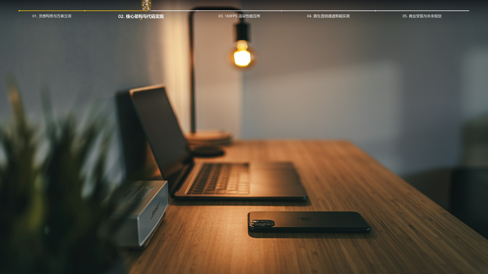
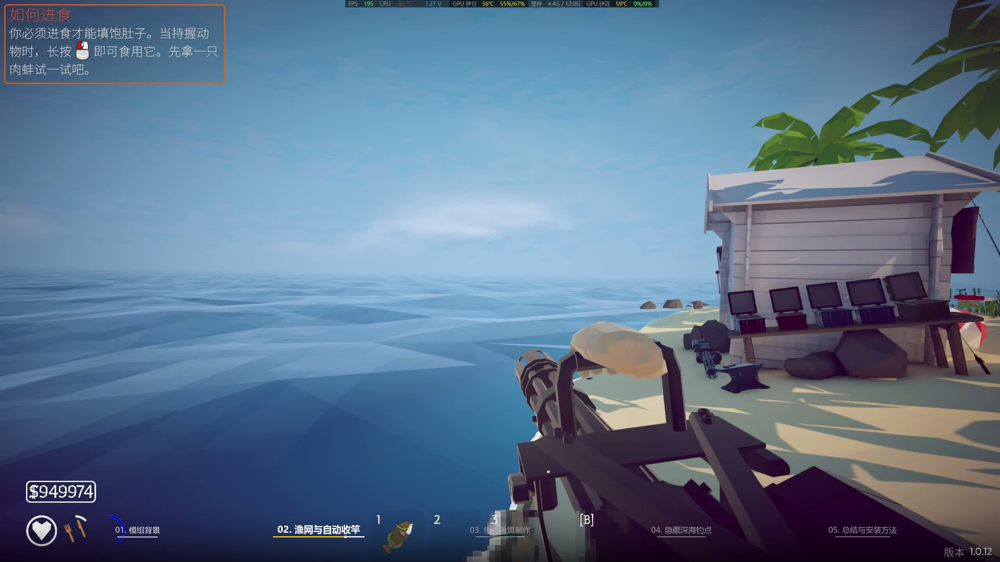
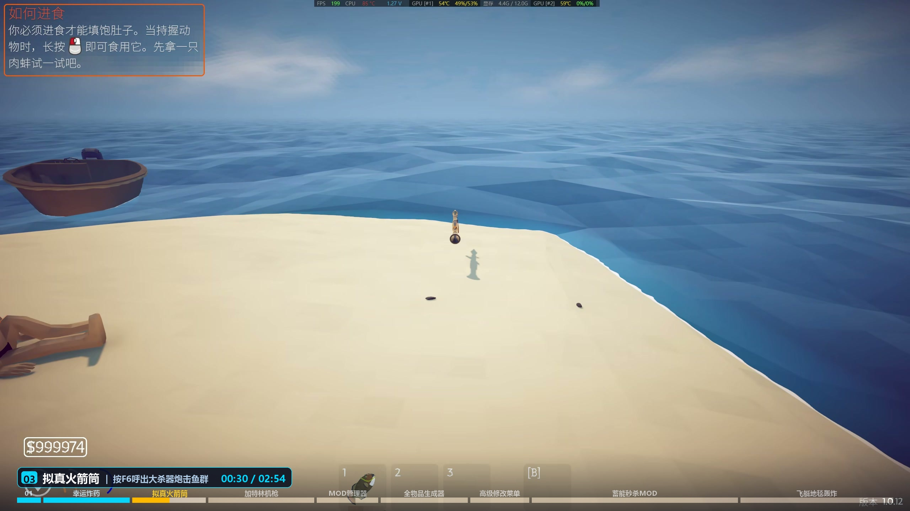
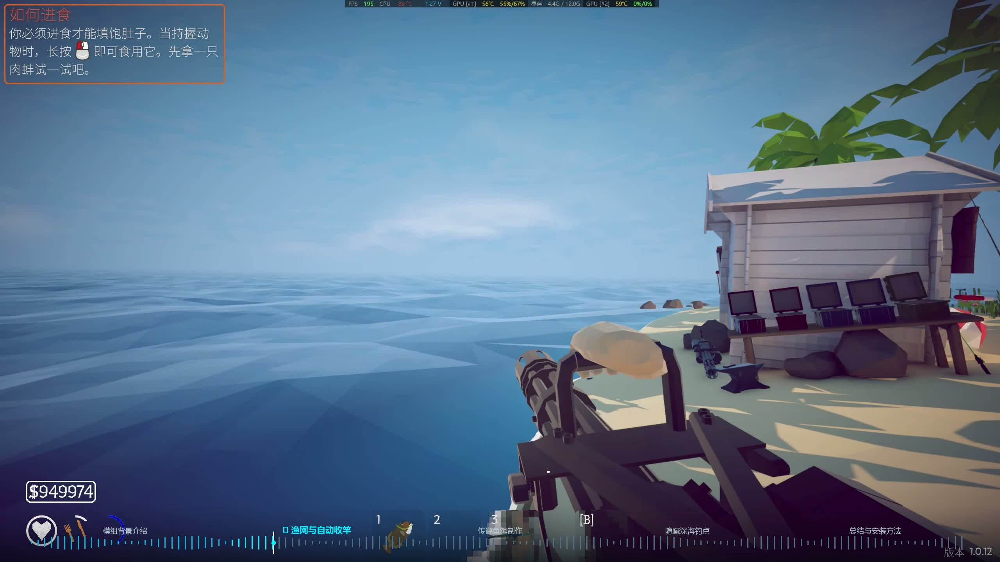
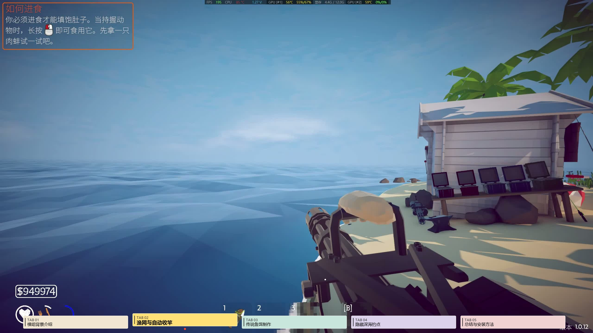

# 🎬 Video Chapter Progress Bar (视频自动分段动态进度条生成器)

[](https://opensource.org/licenses/MIT)
[](https://www.python.org/)
[]()
[]()

> **专为短视频创作者、B站/YouTube UP 主、剪辑师打造的 AI 动态分段进度条引擎。**  
> 一键读入视频/字幕，AI 语义自适应分段，**毫秒级渲染输出带 Alpha 原生透明通道的 QuickTime MOV 素材**，剪映 / Premiere / Final Cut Pro 拖入即用！

---

## ✨ 核心特性

- ⚡ **零环境配置门槛**：内置自包含 FFmpeg 引擎，依赖包仅 **30MB**，无需手动配置系统环境变量，3 秒极速安装。
- 🧠 **Agent 多模态直通**：支持大模型直接多模态读取视频或文案并提取章节，通过 `-c` 参数秒级灌入，零等待直接渲染。
- 🚀 **160+ FPS 极速条带渲染**：攻克 2K/4K 逐帧渲染缓慢痛点，采用局部条带内存加速算法，3 分钟 2K 视频仅需 30 秒导出！
- 💎 **原生 32-bit RGBA 透明通道**：输出 Apple QuickTime RLE (`qtrle`) 格式，直接拖入剪映即可完美透明叠加，零色差、零遮挡。
- 🤖 **智能情境推断 (Auto-Infer)**：输入视频自动识别横竖屏（9:16 自动切顶部防遮挡，16:9 自动切底部经典）；自动识别同级 `.srt` 字幕与 IP 角色素材。
- 🚶 **自定义 IP 角色随动领航**：支持任意上传透明 PNG 角色/宠物，角色脚踩轨道向前漫步，自带自然步态呼吸颠簸动效。
- 🎨 **12 大预设样式库**：涵盖纯底极简、纯文字无框、人声跳动波形、复古黑胶、手账便签、赛博朋克与 5 大 IP 专属跑道。

---

## 🖼️ 效果预览

### 1. 顶部防遮挡版（适合抖音 / 竖屏短视频场景）


### 2. 底部经典版（适合 B站 / YouTube / 横屏大片场景）


---

## 🤖 AI Agent 极速安装与使用指南

本项目完全遵循 **Antigravity / Claude Code / Cursor / Cline / OpenHands 等通用 Agent Skill 规范**。

### 1. 对你的 AI Agent 发送安装指令
你可以直接在对话框中向任何支持技能系统的 Agent 发送以下一句话：

> 💬 **“帮我安装这个视频进度条制作技能：`https://github.com/kekeradish/video-chapter-progressbar.git`，克隆到你的 skills 目录并安装依赖。”**

### 2. Agent 自动化安装命令
Agent 会在后台自动执行以下标准化流程：
```bash
# 1. 克隆到技能目录
git clone https://github.com/kekeradish/video-chapter-progressbar.git

# 2. 安装轻量依赖（仅 30MB，无需安装 PyTorch，自带自包含 FFmpeg）
pip install -r video-chapter-progressbar/requirements.txt
```

### 3. Agent 调度范式
安装完成后，Agent 能够直接多模态理解视频文案，并通过一行命令调度渲染：
```bash
# Agent 直传章节（0 秒推理等待，直接启动渲染）
python scripts/pipeline.py -i "input.mp4" -c "00:00 开篇 01:20 核心实测 02:40 总结"
```

---

## 📦 开发者本地安装

```bash
git clone https://github.com/kekeradish/video-chapter-progressbar.git
cd video-chapter-progressbar
pip install -r requirements.txt
```

---

## ⚡ 快速上手

### 1. 极简用法（智能全自动感知）
无需记忆繁琐参数，系统自动识别横竖屏并匹配顶部/底部布局，自动探测同级字幕与 IP 角色：
```bash
python scripts/pipeline.py -i "input_video.mp4"
```

### 2. 指定章节文本（推荐，秒级极速渲染）
```bash
python scripts/pipeline.py -i "input_video.mp4" -c "00:00 痛点揭秘 01:15 功能拆解 02:30 实战演示 03:20 总结"
```

### 3. 一键直接压制出带进度条的成品 MP4
```bash
python scripts/pipeline.py -i "input_video.mp4" -c "00:00 开篇 01:20 实测" --composite
```

### 4. IP 专属模式：带上你的自定义角色向前漫步
```bash
python scripts/pipeline.py -i "input_video.mp4" -p "ip_minimal_horizon" -m "my_avatar.png"
```

### 5. 外挂字幕文件加速模式
```bash
python scripts/pipeline.py -i "input_video.mp4" -s "subtitle.srt"
```

---

---

## 🎨 样式预设视觉画廊 (Preset Gallery)

系统内置 12 款针对不同视频题材与审美的预设样式，均已完成 2K 级实景调优：

### 🏛️ 系列一：极简与现代无框 (Modern & Minimalist)
*适合数码科技评测、教程、商业宣讲与高端纪录片*

#### 1. 纯底极简经典 (`minimal_bottom`)
> 暖金充能推进、沉浸无遮挡，全场景百搭无压力。  
> 运行命令：`python scripts/pipeline.py -i input.mp4 -p minimal_bottom`


#### 2. 纯文字下划线充能 (`typography_underline`)
> Apple 级无框排版美学，文字下方细线平滑充能，极具呼吸感。  
> 运行命令：`python scripts/pipeline.py -i input.mp4 -p typography_underline`


#### 3. 悬浮胶囊卡片 (`capsule_details`)
> 磨砂毛玻璃悬浮卡片，动态走秒时间戳与章节特性高亮。  
> 运行命令：`python scripts/pipeline.py -i input.mp4 -p capsule_details`


---

### 🎨 系列二：特色质感与创意视觉 (Creative & Retro)
*适合播客长视频、生活 Vlog、音乐分享与游戏解说*

#### 4. 人声音频波形条 (`audio_waveform`)
> 真实声波频谱柱，随说话人声音起伏律动跳跃，科技与视觉冲击力拉满。  
> 运行命令：`python scripts/pipeline.py -i input.mp4 -p audio_waveform`


#### 5. 复古黑胶唱片微播放器 (`vinyl_deck`)
> 拟物自转黑胶唱片、金属走秒唱针、复古橙红进度条，生活 Vlog 与音乐慢视频绝配。  
> 运行命令：`python scripts/pipeline.py -i input.mp4 -p vinyl_deck`


#### 6. 纸质手账便签 (`paper_index_tab`)
> 彩色手账便签纸标签，当前章节自动弹起图钉标记，文艺质感十足。  
> 运行命令：`python scripts/pipeline.py -i input.mp4 -p paper_index_tab`


#### 7. 赛博霓虹双轨 (`cyberpunk`)
> 粉青荧光高能撞色双轨，适合电竞比赛、潮流集锦与炫酷短视频。  
> 运行命令：`python scripts/pipeline.py -i input.mp4 -p cyberpunk`


---

### 🚶 系列三：自定义 IP 随动领航跑道 (Custom Mascot Runners)
*支持任意上传透明 PNG 角色/宠物，角色脚踩轨道向前漫步，自带自然呼吸与上下颠簸步态*

#### 8. 地平线漫步跑道 (`ip_minimal_horizon`)
> 角色脚踩金色细线漫步前进，脚下带微光阴影随动。  
> 运行命令：`python scripts/pipeline.py -i input.mp4 -p ip_minimal_horizon -m avatar.png`


#### 9. 声波浪尖冲浪跑道 (`ip_audio_surfer`)
> 角色踏在跳动的音频波形浪尖上向前冲浪，动感十足。  
> 运行命令：`python scripts/pipeline.py -i input.mp4 -p ip_audio_surfer -m avatar.png`


#### 10. 赛博霓虹跑道 (`ip_cyber_runner`)
> 荧光双轨，角色脚底带有发光推进光效。  
> 运行命令：`python scripts/pipeline.py -i input.mp4 -p ip_cyber_runner -m avatar.png`


#### 11. 手账便签探头 (`ip_memo_peek`)
> 角色趴在便签边缘好奇探头，极具陪伴感与萌趣感。  
> 运行命令：`python scripts/pipeline.py -i input.mp4 -p ip_memo_peek -m avatar.png`


---

## 🙏 致谢 (Acknowledgements)

- [FFmpeg](https://ffmpeg.org/)：提供强大的音视频底层编解码与无损流式推流能力
- [Pillow](https://python-pillow.org/)：高效健壮的图像图形处理库
- [imageio-ffmpeg](https://github.com/imageio/imageio-ffmpeg)：提供跨平台零配置的自包含 FFmpeg 运行环境

---

## 📄 开源许可证

本项目采用 [MIT License](LICENSE) 开源协议。
Copyright (c) 2026 kekeradish

